# 📱 Telas do Aplicativo (UI)

Esta pasta contém as exportações em alta resolução das telas desenvolvidas no Figma para o projeto **Greenstop**.

## 🗺️ Fluxo de Telas

### 1. Apresentação & Autenticação

* **Tela de Apresentação (`tela_de_apresentacao.png`):** Tela introdutória do aplicativo.
   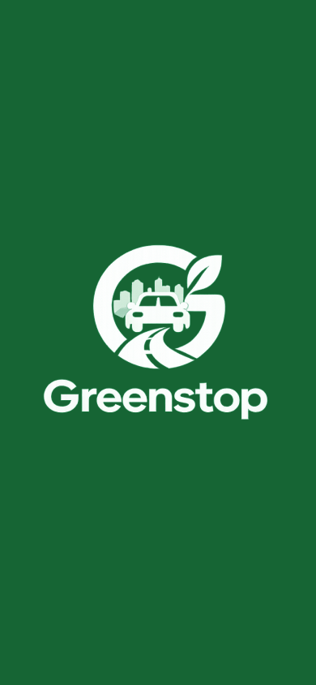

* **Tela Inicial (`tela_inicial.png`):** Tela de boas-vindas com opções de acesso.
   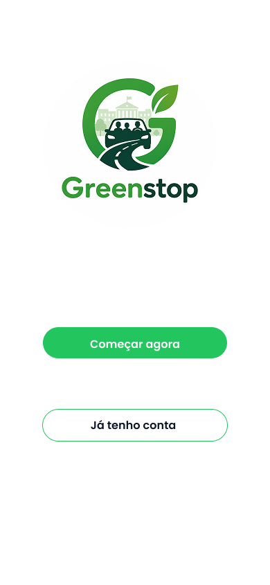

* **Login (`login.png`):** Tela de entrada com suporte a e-mail institucional (`@cs.udf.edu.br`) e conta Microsoft.
   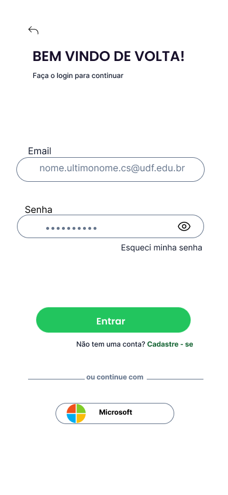

* **Cadastro (`cadastro.png`):** Formulário de criação de conta para novos usuários.
   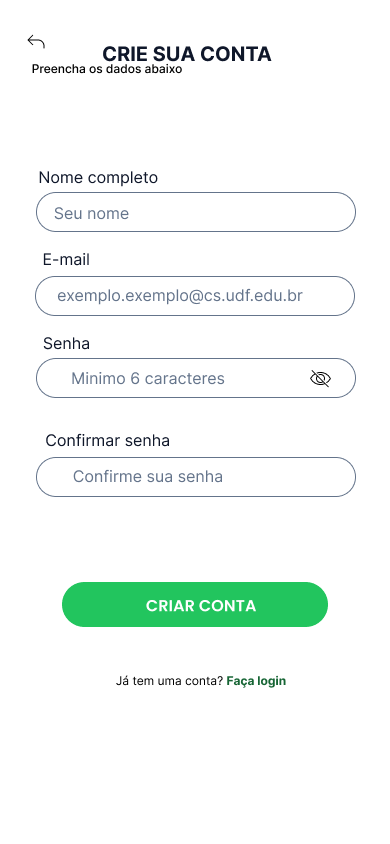

* **Escolha de Perfil (`escolha_perfil.png`):** Seleção de modo de uso (Motorista, Passageiro ou Os dois).
   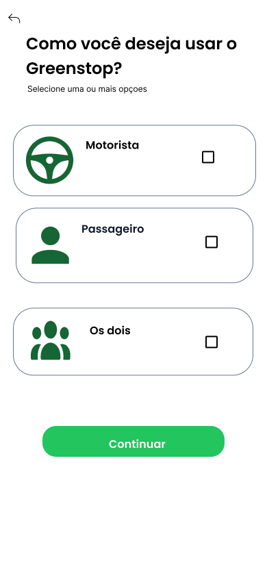

---

### 2. Navegação & Perfil

* **Home (`home.png`):** Tela principal com acesso rápido à busca, oferta de caronas, viagens agendadas, mensagens e perfil.
   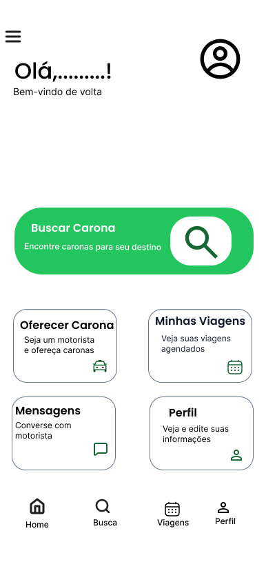

* **Perfil (`perfil.png`):** Visualização e edição das informações do usuário.
   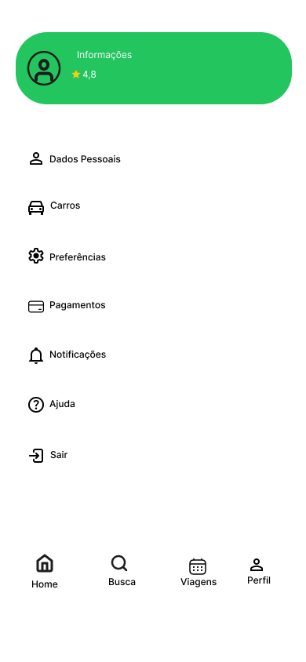

---

### 3. Fluxo de Caronas

* **Buscar Carona (`buscar_carona.png`):** Formulário de pesquisa de rotas, data, horário e valor máximo.
   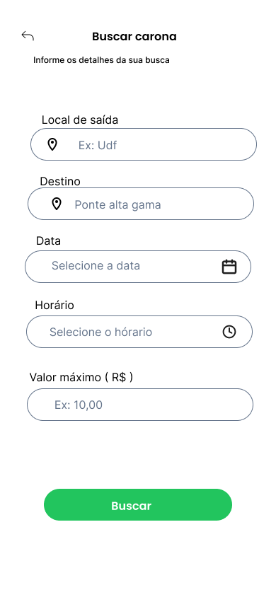

* **Oferecer / Buscar Carona 1 (`buscar_carona1.png`):** Variação do formulário de publicação e busca de rotas.
   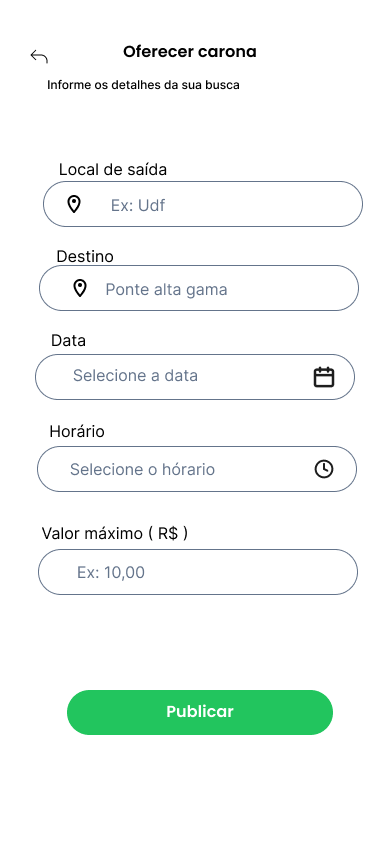

* **Lista de Caronas (`lista_caronas.png`):** Listagem de motoristas disponíveis com avaliações e botão de filtros.
   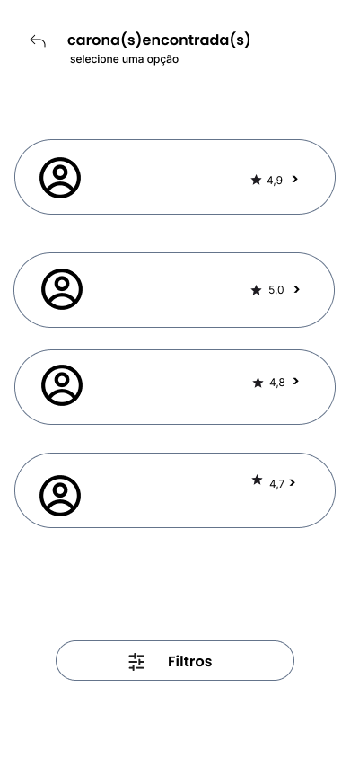

* **Detalhes da Carona (`detalhes_carona.png`):** Resumo da viagem, vagas disponíveis, dados do veículo e solicitação.
   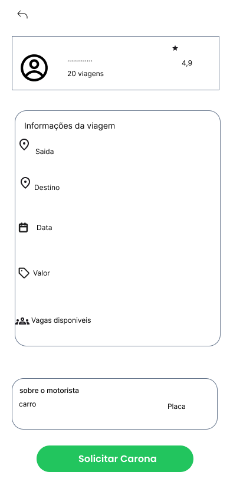

* **Confirmação (`confirmacao.png`):** Feedback visual de pedido enviado ao motorista.
   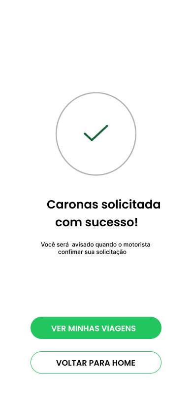

---

### 4. Pós-Viagem

* **Avaliação (`avaliacao.png`):** Sistema de avaliação por estrelas e campo de comentário opcional.
   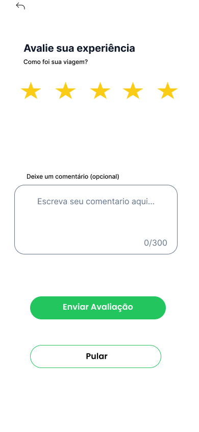
